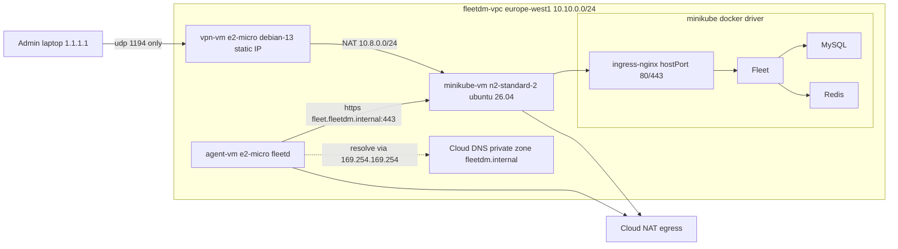

# fleetdm

A Helm chart for [Fleet](https://fleetdm.com) (with bundled MySQL and Redis), and the Terraform/Terragrunt
infrastructure to run it on Minikube on a GCE VM in `europe-west1`, reachable only over OpenVPN.

```
fleetdm/
  terraform-library/   reusable Terraform modules and deployments (google provider ~> 8.12)
  infra/               Terragrunt live config (europe-west1: vpc, firewall, vpn-vm, minikube-vm, agent-vm, dns)
  charts/fleetdm/      the Helm chart
  Makefile             cluster / install / verify helpers, run on minikube-vm
```

## Architecture



- The only externally reachable port is OpenVPN `udp/1194` on `vpn-vm`, from `1.1.1.1/32`. No external
  SSH, ICMP or IAP. Firewall logging is off.
- `minikube-vm` and `agent-vm` have no external IP; they reach the internet through Cloud NAT.
- VPN clients get routes to `10.10.0.0/24` and `169.254.169.254`, and use `169.254.169.254` (the VPC metadata
  resolver) as DNS, so the private zone `fleetdm.internal` resolves on the laptop too.
- TLS terminates at ingress-nginx inside Minikube with a chart-generated CA (`fleet-ca.pem`).

## 1. Infrastructure

### Prerequisites

- `gcloud` authenticated (`gcloud auth login` and `gcloud auth application-default login`).
- Terraform >= 1.3 (tested with 1.15) and Terragrunt >= 1.0.
- A GCS bucket for Terraform state, e.g. `gcloud storage buckets create gs://<bucket> --location=europe-west1`.
- The Compute Engine and Cloud DNS APIs enabled:
  `gcloud services enable compute.googleapis.com dns.googleapis.com`.
- IAM for your user: permission to create the resources (e.g. `roles/compute.admin`, `roles/dns.admin`), plus
  `roles/compute.osAdminLogin` (OS Login SSH with sudo) and `compute.instances.getGuestAttributes`
  (included in `roles/compute.viewer`) to fetch the VPN profile.

### Apply

Fill in `infra/common_locals.yaml`:

```yaml
project_id: "my-project"
state_bucket: "my-tf-state-bucket"
```

Admin source IPs, CIDRs and the zone live in `infra/europe-west1/region.yaml`. Then:

```bash
cd infra/europe-west1
terragrunt run --all plan
terragrunt run --all apply
```

Order (from `dependency` blocks): `vpc` -> `firewall` -> `vpn-vm`, `minikube-vm`, `agent-vm` -> `dns`.
Each unit commits its `.terraform.lock.hcl` (`hashicorp/google` and `google-beta` 8.12.x).

### Connect the VPN

`vpn-vm`'s startup script builds the PKI, starts OpenVPN, and publishes the client profile as a guest attribute
(give it 1-2 minutes after the first boot):

```bash
gcloud compute instances get-guest-attributes vpn-vm --zone europe-west1-b \
  --query-path=openvpn/client --format='value(value)' > fleet-admin.ovpn
chmod 600 fleet-admin.ovpn
```

Import it into Tunnelblick / OpenVPN Connect, or on Linux run `sudo openvpn --config fleet-admin.ovpn`.

On Linux with systemd-resolved, the pushed DNS server is only applied with a helper:
install `openvpn-systemd-resolved` and uncomment the `script-security` / `up` / `down` lines at the top of the
profile. Check with `resolvectl status tun0`.

```bash
dig +short fleet.fleetdm.internal       # -> minikube-vm internal IP
```

## 2. Install on the Minikube VM

`minikube-vm`'s startup script installs `docker.io`, `make`, `git`, `curl`, `jq`, `socat` and pinned
`minikube` v1.39.0, `kubectl` v1.37.2, `helm` v4.3.2 and `fleetctl` 4.95.0
(see `/var/log/syslog` / `journalctl -u google-startup-scripts` for progress).

```bash
gcloud compute ssh minikube-vm --zone europe-west1-b --internal-ip     # over the VPN
sudo usermod -aG docker "$USER" && exit                                 # log in again for the group to apply
gcloud compute ssh minikube-vm --zone europe-west1-b --internal-ip
git clone <this repo> fleetdm && cd fleetdm
make cluster install
```

- `make cluster` starts Minikube (`--driver=docker --cpus=2 --memory=6g --ports=80:80 --ports=443:443`), enables the
  `ingress` addon and waits for the controller. The controller's hostPorts 80/443 are published on the VM's
  `0.0.0.0`, so `https://fleet.fleetdm.internal` works from the VPC and over the VPN.
- `make install` runs `helm upgrade --install fleetdm charts/fleetdm -n fleet --create-namespace --wait --timeout 10m`.
  Extra flags: `make install VALUES="-f my-values.yaml"`.
- `make help` lists all targets; variables: `PROFILE`, `NAMESPACE`, `RELEASE`, `FLEET_HOST`, `CPUS`, `MEMORY`, `VALUES`.

### What the chart deploys

| Component | Kind | Notes |
|-----------|------|-------|
| Fleet | Deployment (1 replica, `Recreate`) | `fleet serve` on :8080, `/healthz` probes, non-root, read-only root FS |
| MySQL `mysql:8.0.46` | StatefulSet + headless Service :3306 | PVC 10Gi, `mysqladmin ping` probes |
| Redis `redis:7.4.12-alpine` | StatefulSet + Service :6379 | `--appendonly yes`, password auth, PVC 1Gi |
| Ingress | `nginx`, host `fleet.fleetdm.internal` | TLS from `fleet-tls-secret` |
| Secrets | MySQL/Redis passwords, Fleet private key, CA + server cert | generated once, kept across upgrades with `lookup` |

Database migrations: with `fleet.autoApplySQLMigrations: true` (default) each Fleet pod runs two init containers,
`wait-for-deps` (waits for MySQL and Redis) and `prepare-db` (`fleet prepare db --no-prompt`). This creates the
schema on first install and applies new migrations after an image upgrade. A Helm `post-install` hook would
deadlock with `--wait` (Fleet cannot become Ready before the migrations), so an init container is used instead.

PVCs use `persistentVolumeClaimRetentionPolicy.whenDeleted: Delete`, so they are removed with the StatefulSets
(set `mysql.persistentVolumeClaimRetentionPolicy.whenDeleted: Retain` to keep data).

Bring your own credentials with `fleet.existingSecret` (`server-private-key`), `mysql.existingSecret`
(`mysql-password`, `mysql-root-password`) and `redis.auth.existingSecret` (`redis-password`).

## 3. Verification

```bash
kubectl -n fleet get pods,svc,ingress,pvc
make verify                                   # helm test: Fleet /healthz, mysqladmin ping, redis-cli ping

# Migrations ran
kubectl -n fleet logs deploy/fleetdm-fleet -c prepare-db
kubectl -n fleet exec fleetdm-mysql-0 -- sh -c 'MYSQL_PWD="$MYSQL_PASSWORD" mysql -ufleet fleet -e "SHOW TABLES" | head'
kubectl -n fleet exec fleetdm-mysql-0 -- sh -c 'MYSQL_PWD="$MYSQL_ROOT_PASSWORD" mysqladmin -uroot -h127.0.0.1 ping'

# Redis
kubectl -n fleet exec fleetdm-redis-0 -- redis-cli ping        # PONG

# TLS and DNS
make ca                                       # writes fleet-ca.pem
curl --cacert fleet-ca.pem https://fleet.fleetdm.internal/healthz
```

From `agent-vm` (copy `fleet-ca.pem` there first, see below) and from the laptop over the VPN:

```bash
dig +short fleet.fleetdm.internal
curl --cacert fleet-ca.pem https://fleet.fleetdm.internal/healthz
```

Open `https://fleet.fleetdm.internal` in a browser (import `fleet-ca.pem` as a trusted CA, or accept the warning).

## 4. Agent enrollment

On `minikube-vm`:

```bash
make fleet-setup ADMIN_EMAIL=admin@example.com ADMIN_PASSWORD='S3cure-passw0rd!'   # first admin + fleetctl login
make agent-package                                   # fleet-osquery_<version>_amd64.deb, enrolled with the CA
gcloud compute scp --zone europe-west1-b --internal-ip fleet-osquery_*_amd64.deb fleet-ca.pem agent-vm:~
```

On `agent-vm` (`gcloud compute ssh agent-vm --zone europe-west1-b --internal-ip`):

```bash
sudo dpkg -i fleet-osquery_*_amd64.deb
systemctl status orbit
```

Back on `minikube-vm`: `fleetctl get hosts` should list `agent-vm` within a minute or two.

## 5. Teardown

```bash
make uninstall            # on minikube-vm: helm uninstall, delete PVCs and the namespace
make cluster-delete
cd infra/europe-west1 && terragrunt run --all destroy     # from the laptop
```

## Published chart

Every merge to `main` that bumps `charts/fleetdm/Chart.yaml` `version` publishes the chart:

```bash
# GitHub Pages (chart-releaser)
helm repo add fleetdm https://<owner>.github.io/<repo>
helm repo update
helm upgrade --install fleetdm fleetdm/fleetdm -n fleet --create-namespace

# GHCR (OCI)
helm upgrade --install fleetdm oci://ghcr.io/<owner>/charts/fleetdm --version 0.1.0 -n fleet --create-namespace
```

One-time GitHub setup:

1. Push this repo to GitHub with `main` as the default branch.
2. Create an empty `gh-pages` branch:
   `git switch --orphan gh-pages && git commit --allow-empty -m "init gh-pages" && git push origin gh-pages`.
3. Settings -> Pages: deploy from branch `gh-pages`, `/ (root)`.
4. Settings -> Actions -> General -> Workflow permissions: "Read and write permissions".
5. After the first release, make the `charts/fleetdm` package on GHCR public (Package settings -> Change visibility).

## CI

- `.github/workflows/lint-test.yaml` (pull requests): `ct lint` (incl. version-increment check), `ct install` on kind
  (uses `charts/fleetdm/ci/ci-values.yaml`, runs `helm test`), and `terraform fmt -check` /
  `terragrunt hcl fmt --check` on `infra/` and `terraform-library/`.
- `.github/workflows/release.yaml` (push to `main` touching `charts/**`): chart-releaser (GitHub Release
  `fleetdm-<version>` + `index.yaml` on `gh-pages`), then `helm push` to `oci://ghcr.io/<owner>/charts`.

Local checks: `make lint`, `terraform fmt -check -recursive infra terraform-library`,
`cd infra/europe-west1 && terragrunt run --all validate` (uses mock outputs; needs GCP credentials for the state bucket).

## Troubleshooting

- **VPN profile not available**: the guest attribute appears once the startup script finishes.
  `gcloud compute instances get-serial-port-output vpn-vm --zone europe-west1-b | grep -i openvpn`.
  Re-run with `gcloud compute instances reset vpn-vm` (the script is idempotent and keeps the PKI).
- **`fleet.fleetdm.internal` does not resolve on the laptop**: the pushed DNS was not applied (Linux:
  systemd-resolved helper above). Test with `dig @169.254.169.254 fleet.fleetdm.internal`.
- **Ingress not reachable on the VM's IP**: check `docker port fleetdm` shows `80` and `443`. If the cluster was created
  without `--ports`, recreate it (`make cluster-delete cluster`) or forward with socat:

  ```bash
  sudo tee /etc/systemd/system/fleet-ingress-forward.service >/dev/null <<EOF
  [Unit]
  Description=Forward :443 to the minikube ingress
  After=docker.service
  [Service]
  ExecStart=/usr/bin/socat TCP-LISTEN:443,fork,reuseaddr TCP:$(minikube -p fleetdm ip):443
  Restart=always
  [Install]
  WantedBy=multi-user.target
  EOF
  sudo systemctl daemon-reload && sudo systemctl enable --now fleet-ingress-forward
  ```

- **Fleet pod stuck in `Init`**: `kubectl -n fleet logs deploy/fleetdm-fleet -c wait-for-deps` (MySQL/Redis not
  Ready; see `kubectl -n fleet describe pod fleetdm-mysql-0`) or `-c prepare-db` (migration errors).
- **MySQL fails on first start with "data directory has files in it"**: the StorageClass created a non-empty volume
  (e.g. `lost+found`). MySQL 8.0 has no `--ignore-db-dir`; use a StorageClass that provisions empty volumes, as
  Minikube's default `standard` does.
- **Agent cannot enroll**: on `agent-vm`, `curl --cacert fleet-ca.pem https://fleet.fleetdm.internal/healthz`; check
  `journalctl -u orbit`. The package must be built with `--fleet-certificate=fleet-ca.pem` (done by `make agent-package`).
- **Credentials changed after reinstall**: generated secrets are kept only while the release exists. `make uninstall`
  also deletes the PVCs, so a fresh install initializes MySQL with the new passwords.
